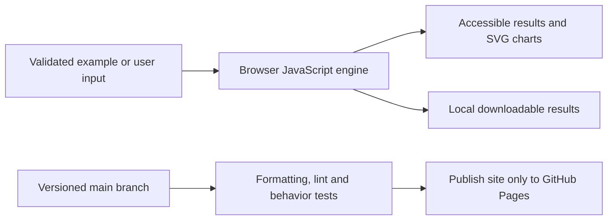

# WhatsApp Conversation Explorer

[Open the application](https://subhashdixit.github.io/whatsapp-conversation-explorer/) · [Report an issue](https://github.com/subhashdixit/whatsapp-conversation-explorer/issues)

Turn a WhatsApp text export into local, inspectable activity patterns without uploading private conversations. This app extends the earlier portfolio parser with conversation-session and adjacent speaker-transition summaries.

## What the finished application does

- Import supported Android/iOS text exports, choose DMY or MDY and analyze in a Web Worker.
- Filter activity by participant and date, compare monthly/hourly counts and inspect parser coverage.
- Inspect full-chat sessions and adjacent speaker-transition median gaps.
- Keep aliases by default, optionally show names locally, and export aggregate alias counts.
- Clear the worker and result without persisting chat bodies.

## Use the application step by step

1. Open the live application. Read the input labels and scope panel.
2. Start with the included example to understand the output.
3. Replace it with your own supported input. Files are processed locally unless you explicitly choose a server feature and consent to it.
4. Run the analysis and inspect the visual output together with its limitations.
5. Export your results when the tool offers a download. Keep your own copy; a browser tab is not a durable data store.

## Concepts, algorithms and interpretation

### Parse first, measure second

A validated timestamp header starts a message; continuation lines attach to it. English AM/PM and bracketed iOS variants are supported. System entries are counted separately. Calendar validation rejects impossible dates, and explicit date ordering avoids guessing ambiguous dates. Parsing coverage is part of the result because unsupported lines change the denominator.

### Conversation sessions and transitions

The first message starts a session. A gap over 60 minutes starts another; a backwards timestamp is reported and starts a new session rather than producing a negative gap. When adjacent sender IDs differ within a session, record their gap. Self-message runs do not create transitions. For gaps [1,3], median = 2 minutes. These are observations about adjacency, not measured replies: a sender may be responding to something else or reading offline. Full-chat transition statistics are deliberately labelled separately from filtered activity charts.

### Counts and visual interpretation

Message counts are exact for recognized parsed records. Words and media markers use heuristics; emoji count uses grapheme segmentation when the browser supports it. Monthly and wall-clock-hour charts expose activity distribution, not sentiment or relationship quality. Exported CSV uses aliases and omits word content. Private words can still appear in an optional local frequency panel; avoid sharing screenshots of it unintentionally.

## Architecture and data flow



HTML provides the accessible page structure, CSS handles responsive layout, and ES modules separate calculation from user interaction. Pure calculation functions can run in Node tests without a browser. SVG charts scale with the screen; they use explicit axes, labels and legends. CSV exports escape spreadsheet formula prefixes in text cells.

The chat parser runs in `site/worker.js` and returns aggregates rather than message bodies. `site/parser.js` handles timestamps and activity; `site/engine.js` adds conversation-turn statistics; `site/charts.js` renders accessible tables and SVG. The source CSP permits only same-origin scripts/worker/network and blocks object embedding. This application makes no chat-content API requests.

## Run locally from scratch

Install Node.js 22 and Python 3 for a local static HTTP server. Python is not a production backend for this app.

```bash
git clone https://github.com/subhashdixit/whatsapp-conversation-explorer.git
cd whatsapp-conversation-explorer
npm ci
npm test
npm run lint
npm run format
npm run check
python3 -m http.server 8000 --directory site
```

Open http://localhost:8000. Use HTTP rather than double-clicking HTML so that module imports and local data fetches work consistently. No production API secret belongs in `site/`.

## Coding structure

```text
site/
  index.html       # accessible application interface
  styles.css       # responsive design
  app.js           # interface orchestration
  engine.js        # validated calculations; no DOM dependency
  ui.js            # chart, CSV and download helpers
tests/             # behavior and boundary cases
.github/workflows/pages.yml
archive/           # original README and retired workflows where present
```

Original source files, notebooks and historical artifacts remain in the repository for comparison. The release publishes only `site/`; old source directories and datasets are not automatically exposed by the application.

## CI/CD and deployment

CI means continuous integration: each pull request and main-branch push installs exact lockfile dependencies, checks formatting, lints JavaScript, runs meaningful behavior tests and checks module syntax. A failed check stops publishing. CD means continuous deployment: after the required `Build and test` check succeeds on `main`, GitHub Actions uploads `site/` and GitHub Pages serves it over HTTPS.

The workflow uses pinned action revisions, minimal permissions and a protected main branch. Publishing jobs need Pages/OIDC permissions; test jobs only read source. Feature branches are deleted after merge. Static Pages hosting needs no always-running Python process, but cannot hide secrets, host a Flask process or provide durable server storage.

To set up a fork, enable GitHub Pages with **GitHub Actions** as its source and allow the repository's workflow to run. Repository Settings → Pages shows the deployment URL. If renaming the repository, update the README URL and any absolute links; application resources use relative paths. Check Actions logs if publishing fails.

### Release, monitoring and rollback

A commit identifies exactly which source was deployed. Inspect the Actions deployment and test results before sharing the link. After publishing, open the page, run its example and check exports; a successful HTTP response alone is not a functional test. For rollback, revert the faulty merge in a new PR, pass checks, and merge the revert. This triggers the same reproducible publishing process. Avoid force-pushing protected main or deleting history. Browser caches can retain an older asset briefly; refresh after a deployment.

### Docker and alternatives

Docker packages code and dependencies into a reproducible runtime. This static app does not require a container: Pages serves the same versioned files directly, with less operating work and no container cold starts. A container becomes useful if adding a Python backend; then secrets, patches, resource costs and persistent storage require separate management.

## Data provenance and attribution

Original Whatsapp_Chat_Analyzer_WebApp code retained. The maintained parser and chart helpers were adapted from the owner’s earlier `whatsapp-chat-insights` portfolio app. The included 240-message fixture is synthetic with fictional participants, not a personal chat.

## Practical limits

10 MiB, 200,000 lines, 100,000 messages and 5,000 participants. Localized unsupported timestamp markers and quoted messages that resemble new headers can affect parsing. No timezone or daylight-saving inference. Chats are not stored by app code, but normal website requests carry routine network metadata. Browser memory and files remain under the user’s device controls.

The test suite checks calculation contracts and invalid inputs. It cannot establish that an input dataset is representative, that a heuristic is scientifically correct for every domain, or that a result is suitable for an automated consequential decision. Read the original source alongside the maintained browser implementation when comparing behavior.
