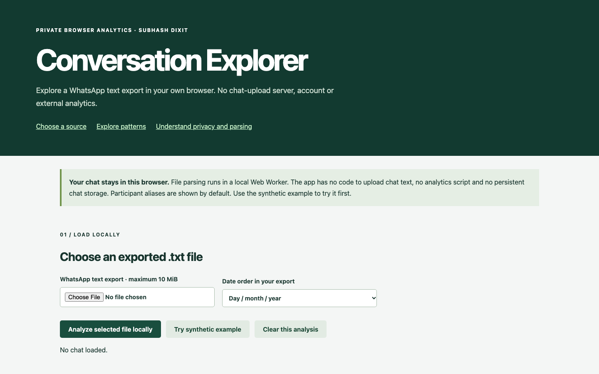
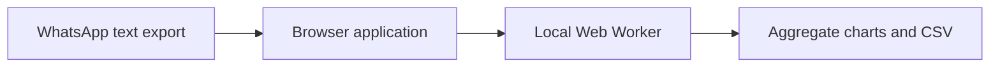
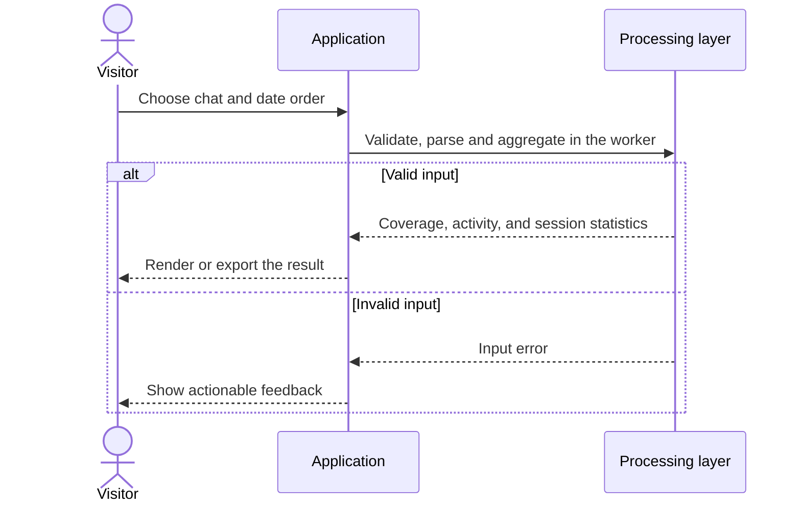
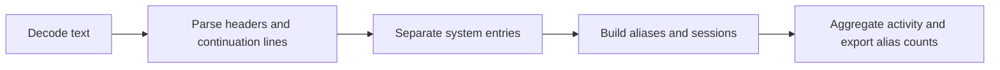
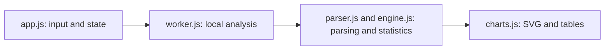
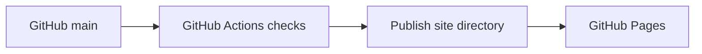

# WhatsApp Conversation Explorer

## 1. Project overview

Turn a WhatsApp text export into an activity summary that can be inspected locally. The repository implements format-aware parsing, session and speaker-transition statistics, charts, and alias-based aggregate exports.

[Live demo](https://subhashdixit.github.io/whatsapp-conversation-explorer/) · [Source repository](https://github.com/subhashdixit/whatsapp-conversation-explorer)



## 2. Motivation and problem statement

### Objective

Measure who participated and when, where activity clustered, and how sessions and adjacent speaker changes appear in a supported WhatsApp export.

### Problem statement

Given a chronological text export, recognize message headers, join continuation lines, separate system entries, and report parsing coverage before calculating aggregates. Date-order and format differences can change which records are counted.

### Motivation

A raw export is difficult to review by participant or time period, and a conversation can contain private text. Local processing lets users inspect date and participant patterns, see which lines the parser recognized, and share an alias-based aggregate export.

## 3. Solution and scope

- Import supported Android/iOS text exports, choose DMY or MDY and analyze in a Web Worker.
- Filter activity by participant and date, compare monthly/hourly counts and inspect parser coverage.
- Inspect full-chat sessions and adjacent speaker-transition median gaps.
- Keep aliases by default, optionally show names locally, and export aggregate alias counts.
- Clear the worker and result without persisting chat bodies.

## 4. Quick start and usage

1. Open the live demo and load its synthetic chat or choose a supported WhatsApp text export.
2. Select DMY or MDY to match the export and run the analysis.
3. Inspect parser coverage, filter activity by date or participant, and compare the full-chat session and speaker-change summaries.
4. Download alias-level aggregate counts or clear the analysis.

## 5. High-level architecture



## 6. End-to-end request workflow



## 7. Data sources, inputs, and outputs

Original Whatsapp_Chat_Analyzer_WebApp code retained. The maintained parser and chart helpers were adapted from the owner’s earlier `whatsapp-chat-insights` portfolio app. The included 240-message fixture is synthetic with fictional participants, not a personal chat.

Inputs are a UTF-8 text export and a date-order choice. Output includes parser coverage, date/hour counts, participant aggregates, session summaries, and adjacent speaker-transition gaps.

## 8. Data flow and ETL pipeline



## 9. Low-level design and interfaces



## 10. Concepts and algorithms

### Parse first, measure second

A validated timestamp header starts a message; continuation lines attach to it. English AM/PM and bracketed iOS variants are supported. System entries are counted separately. Calendar validation rejects impossible dates, and explicit date ordering avoids guessing ambiguous dates. Parsing coverage is part of the result because unsupported lines change the denominator.

### Conversation sessions and transitions

The first message starts a session. A gap over 60 minutes starts another; a backwards timestamp is reported and starts a new session rather than producing a negative gap. When adjacent sender IDs differ within a session, record their gap. Self-message runs do not create transitions. These are observations about adjacency, not measured replies: a sender may be responding to something else or reading offline. Full-chat transition statistics are deliberately labelled separately from filtered activity charts.

### Counts and visual interpretation

Message counts are exact for recognized parsed records. Words and media markers use heuristics; emoji count uses grapheme segmentation when the browser supports it. Monthly and wall-clock-hour charts expose activity distribution, not sentiment or relationship quality. Exported CSV uses aliases and omits word content. Private words can still appear in an optional local frequency panel; avoid sharing screenshots of it unintentionally.

## 11. Technology choices and dependencies

| Technology | Role and rationale |
| --- | --- |
| JavaScript ES modules | Keep parsing, aggregation, and interface logic separate. |
| Web Worker | Process bounded chat input away from the UI thread. |
| SVG and HTML tables | Display aggregates with readable labels and structure. |
| Node and GitHub Actions | Exercise parser and transition contracts before publishing. |

[Dependency versions and reproducible setup](DEPENDENCIES.md)

## 12. Training, inference, and evaluation

The app computes deterministic statistics from each imported export. It has no fitted model. Parser tests cover supported timestamp variants and invalid input. Transition tests exercise session gaps and adjacent speaker changes. Run `npm test`. [Test sources](tests/)

## 13. Limitations and data handling

10 MiB, 200,000 lines, 100,000 messages and 5,000 participants. Localized unsupported timestamp markers and quoted messages that resemble new headers can affect parsing. No timezone or daylight-saving inference. Chats are not stored by app code, but normal website requests carry routine network metadata. Browser memory and files remain under the user’s device controls.

## 14. Installation and local setup

Install Node.js 22 and Python 3 for a local static HTTP server. Python is not a production backend for this app.

```bash
git clone https://github.com/subhashdixit/whatsapp-conversation-explorer.git
cd whatsapp-conversation-explorer
npm ci
npm test
npm run lint
npm run format
npm run check
python3 -m http.server 8000 --directory site
```

Open http://localhost:8000. Use HTTP rather than double-clicking HTML so that module imports and local data fetches work consistently. No production API secret belongs in `site/`.

## 15. Repository structure

```text
site/
  index.html       # accessible application interface
  styles.css       # responsive design
  app.js           # interface orchestration
  engine.js        # validated calculations; no DOM dependency
  ui.js            # chart, CSV and download helpers
tests/             # behavior and boundary cases
.github/workflows/pages.yml
archive/           # original README and retired workflows where present
```

Original source files, notebooks and historical artifacts remain in the repository for comparison. The release publishes only `site/`; old source directories and datasets are not automatically exposed by the application.

## 16. Deployment and operations



CI means continuous integration: each pull request and main-branch push installs exact lockfile dependencies, checks formatting, lints JavaScript, runs meaningful behavior tests and checks module syntax. A failed check stops publishing. CD means continuous deployment: after the required `Build and test` check succeeds on `main`, GitHub Actions uploads `site/` and GitHub Pages serves it over HTTPS.

The workflow uses pinned action revisions, minimal permissions and a protected main branch. Publishing jobs need Pages/OIDC permissions; test jobs only read source. Feature branches are deleted after merge. Static Pages hosting needs no always-running Python process, but cannot hide secrets, host a Flask process or provide durable server storage.

To set up a fork, enable GitHub Pages with **GitHub Actions** as its source and allow the repository's workflow to run. Repository Settings → Pages shows the deployment URL. If renaming the repository, update the README URL and any absolute links; application resources use relative paths. Check Actions logs if publishing fails.

### Release, monitoring and rollback

A commit identifies exactly which source was deployed. Inspect the Actions deployment and test results before sharing the link. After publishing, open the page, run its example and check exports; a successful HTTP response alone is not a functional test. For rollback, revert the faulty merge in a new PR, pass checks, and merge the revert. This triggers the same reproducible publishing process. Avoid force-pushing protected main or deleting history. Browser caches can retain an older asset briefly; refresh after a deployment.

### Docker and alternatives

Docker packages code and dependencies into a reproducible runtime. This static app does not require a container: Pages serves the same versioned files directly, with less operating work and no container cold starts. A container becomes useful if adding a Python backend; then secrets, patches, resource costs and persistent storage require separate management.

## 17. License, credits, and support

Project by **Subhash Dixit**. The repository has no standalone code license file. Dataset and dependency terms are described separately where applicable. Report bugs or documentation issues with synthetic reproduction inputs.

[GitHub Issues](https://github.com/subhashdixit/whatsapp-conversation-explorer/issues)
